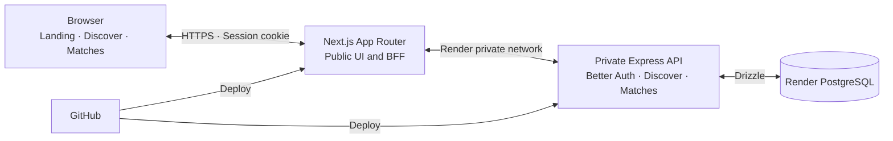
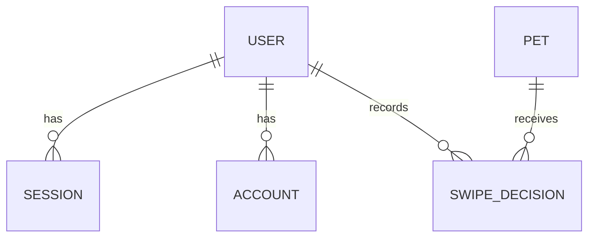
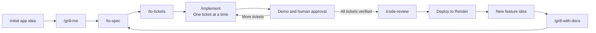

# Pawprint MVP Specification

## Product goal

Build Pawprint from scratch as a Tinder-inspired pet discovery app. Visitors can create an account, browse fictional pet profiles, pass on pets, and save pets to a private Matches gallery. The interface is colorful, with edge-to-edge photography on Discover cards.

## Landing and authentication

- The public landing page briefly introduces Pawprint and invites visitors to sign in.
- Users can register and sign in with email and password through Better Auth. Registration gives immediate access to Discover without email verification.
- Discover, swipe decisions, and Matches require a valid session. Express validates the session and identifies the account for each request.

## Discover

- Use the same fixed catalog of 67 fictional profiles in development and production, with one profile per supplied photo. Photos are under `https://pets-images.dev-apis.com/pets/`: `dog1.jpg` through `dog39.jpg`, `cat1.jpg` through `cat14.jpg`, `bird1.jpg` through `bird9.jpg`, `rabbit1.jpg` through `rabbit3.jpg`, and `reptile1.jpg` through `reptile2.jpg`.
- Show one pet at a time in a stable order. Support visible **Pass** and **Save** buttons, mouse drag, keyboard arrows, and touch gestures. Left means Pass and right means Save.
- **Pass** skips a pet for the current round. **Save** adds it to private Matches and excludes it from future rounds. Progress persists across reloads and devices for the same account.
- At the end of a round with passed pets, show **“You’ve seen all the pets”** and **“Explore again”**. Starting another round restores only passed pets in their original order.
- When every pet is saved, show **“You’ve saved all available pets”** and **“View Matches”**.
- If a swipe cannot be confirmed, keep its card visible and offer **“Try again”**. If Express already stored the decision and its response was lost, retrying confirms the original result and leaves a single entry in Matches.

## Matches

Show a private gallery of saved pets. Each card shows its photo, name, species, and age. An empty gallery shows **“No matches yet”** and **“Go to Discover”**.

## Architecture and delivery

Next.js App Router serves the UI and acts as the public BFF. Use TypeScript, vanilla-extract, Radix UI Primitives where appropriate, and ESLint. The BFF forwards requests to Express over Render's private network and relays session cookies. Express hosts Better Auth, owns catalog and swipe logic, and accesses Render PostgreSQL through Drizzle.

GitHub is the deployment source for both Render services. Next.js is the only public service. The UI and project files are in English, including filenames, documentation, tickets, code comments, test descriptions, and diagram labels.

## Data relationships

One PostgreSQL database holds authentication records, the pet catalog, and each user's decisions. Matches comes from saved decisions. Passed decisions determine which pets are eligible in the current round. The schema for round state and retry handling will be decided during technical design.

## Acceptance scenarios

| Scenario | Expected result |
| --- | --- |
| A visitor registers with email and password. | They can enter Discover immediately. |
| A user passes on Luna, then signs in on another device. | Luna stays excluded from the current round. |
| A user saves Milo and finishes the round. | Milo appears in Matches. **Explore again** brings back only passed pets in their original order. |
| A user saves the last unsaved pet. | Discover offers **View Matches**. |
| Express stores a save and the browser loses the response. | The card stays visible. **Try again** confirms the save and Matches contains one entry for that pet. |
| A second account opens Matches. | It sees only its own saved pets. An empty gallery offers **Go to Discover**. |
| A user passes or saves using any supported input. | Each input produces the same result for the same decision. |

## Testing boundaries

Use the public browser flow to verify registration, session cookies through the BFF, input controls, round transitions, and Matches. Use the Express API with a test database to verify session enforcement, account isolation, and retries after a decision has already been stored.

## Out of scope

Removing pets from Matches, Google sign-in, and password recovery are candidates for later features. Pet detail pages and adoption applications are outside the MVP.

## Project workflow

